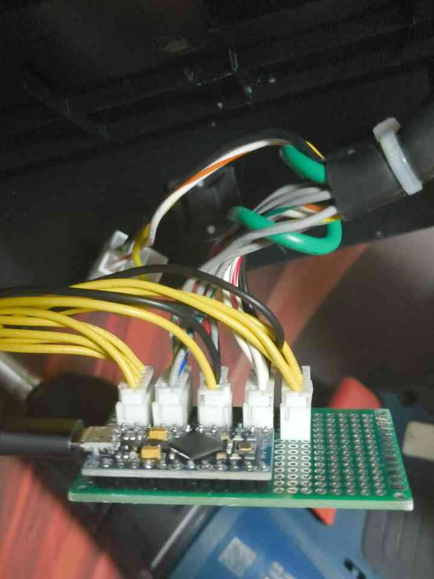
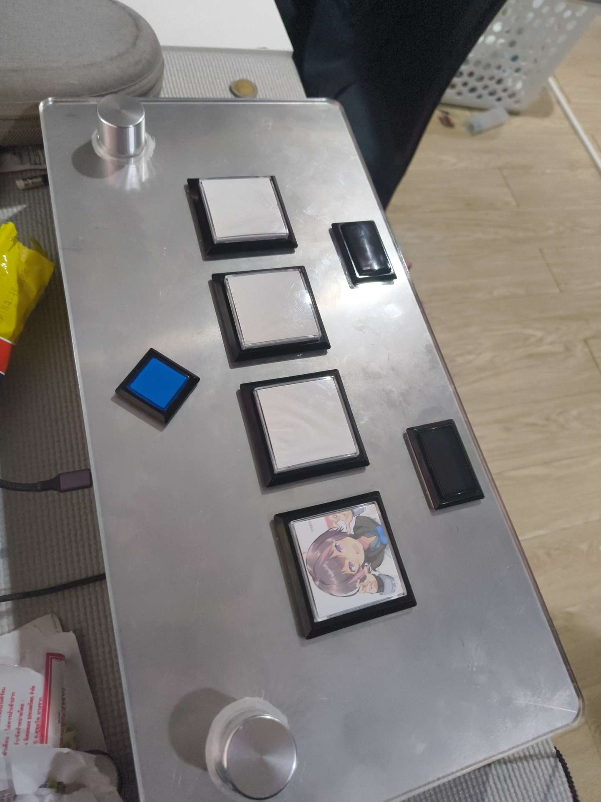

The physical side of my controller projects: the parts you actually touch, and everything hidden underneath.

## What I design
- Button assemblies and encoder knobs
- Enclosures and mounts for touch panels
- Connectors and cable routing
- Ways to dampen vibration and noise

I model parts in Fusion 360 and 3D print them to test fit and feel, then adjust. A lot of it is about tolerances: a button that's 0.2 mm too tight feels completely different.

## From perfboard to finished

*My ChunithmIO board, hand-soldered on perfboard with JST connectors for the wiring.*

*A finished controller: brushed metal top, two knobs and square buttons.*
