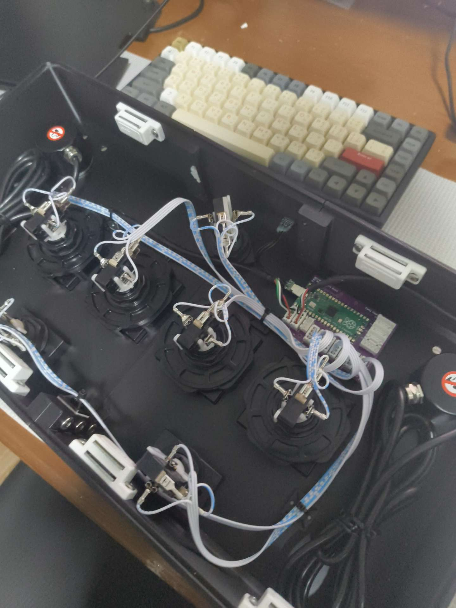

FlufflyFlash is a board I designed so I don't have to hand-wire a Pico into every controller I build. The Pico sits on top, and everything else plugs into labelled JST connectors: buttons, their LEDs and the rest of the controller.

*Installed in a button controller. Each button plugs straight into the board instead of being soldered to the Pico.*

<!-- TODO: add the pinout, which games/modes it supports, and what you'd change in the next revision. -->
