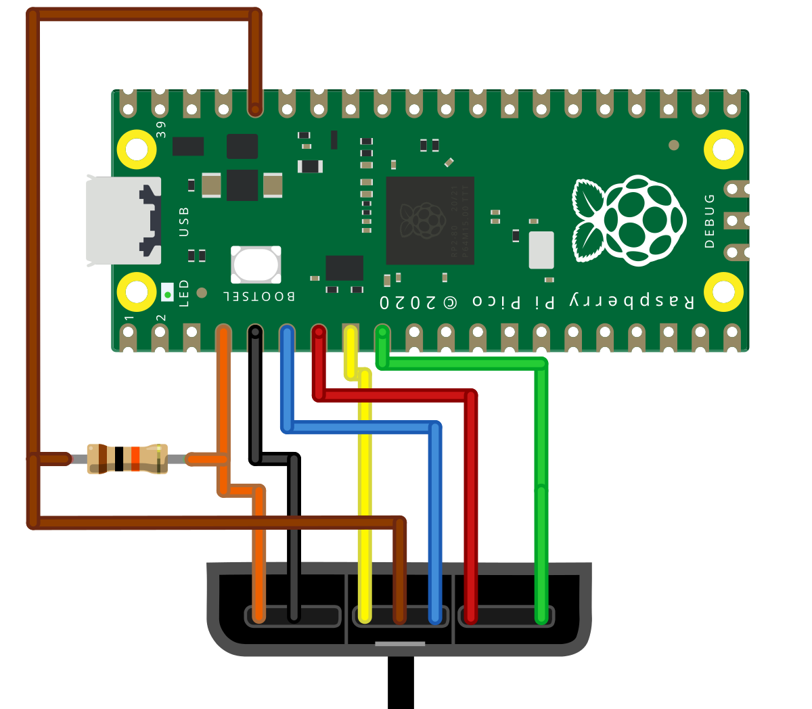

PicoPS2PopN is firmware for the Raspberry Pi Pico, written in C with the Pico SDK and TinyUSB. It talks to a KONAMI Pop'n Music PS2 controller over the PS2 protocol and shows up on a PC as a normal USB controller, so the original hardware works without an adapter. It also works with other PS2 and PS1 pads, like a DualShock 2.

## How it connects
The controller plugs straight into the Pico: data, command, attention and clock go to four GPIO pins, and the controller runs from the Pico's 3.3 V output. The one extra part is a 10 kΩ pull-up resistor on the data line. Everything stays at 3.3 V, so nothing on the controller side touches the 5 V USB supply.

*The full wiring: four signal lines, 3.3 V, ground and one pull-up resistor.*

## What it does
- **Pop'n controller mode:** all 9 buttons plus Select and Start, as a USB HID controller.
- **Keyboard mode:** hold Select while plugging in and the buttons send key presses instead, for games that only take keyboard input.
- **Other PS2 pads:** a regular gamepad mapping, with an option to send the D-pad as a hat switch.
- **No-button flashing:** hold Select + Start while plugging in to put the Pico into BOOTSEL mode, so updating the firmware doesn't mean opening anything up.
- **Status LED:** blinks while it's looking for a controller, stays solid once one is connected.

It polls the controller every 2 ms. The PS2 clock timing can be slowed down for long cables, and the pins, button layout and keymap are all configurable in the source.

## Build it
The repository has the full wiring tables, build steps (VS Code Pico extension, or CMake and Ninja), flashing instructions and troubleshooting.
