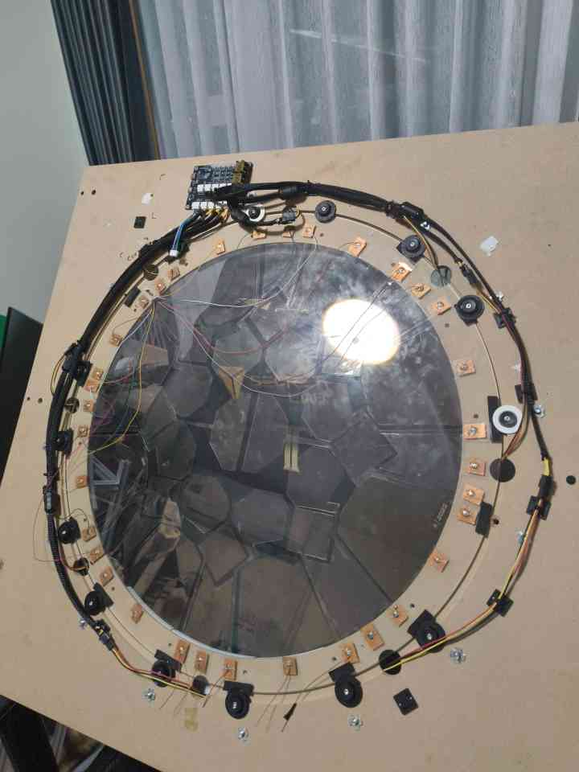

A custom touch controller for rhythm games. The hard part isn't reading one touch sensor, it's reading a lot of them quickly enough that the controller still feels instant.

## The board
The Touchboard is my touch-sensing PCB. It reads 34 touch channels through four connectors (1–9, 10–18, 19–27 and 28–34), with a resistor on every channel and a programming header (SWD) on the edge so I can flash and debug it in place.

## The panel

*The prototype panel: copper touch pads under the acrylic, buttons and wiring around the ring.*

## What I'm working on
- **Sensing:** reading touch pads through the acrylic reliably, without false touches.
- **Speed:** total scan time across all 34 zones, and how that adds up against the latency I'm aiming for.
- **Input:** reporting to the PC over USB HID at a high report rate.

<!-- TODO: add scan-time measurements once you have them. -->
